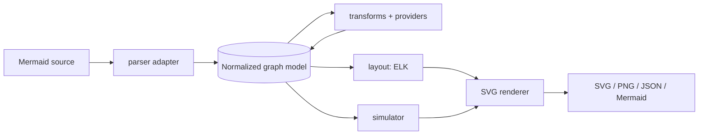
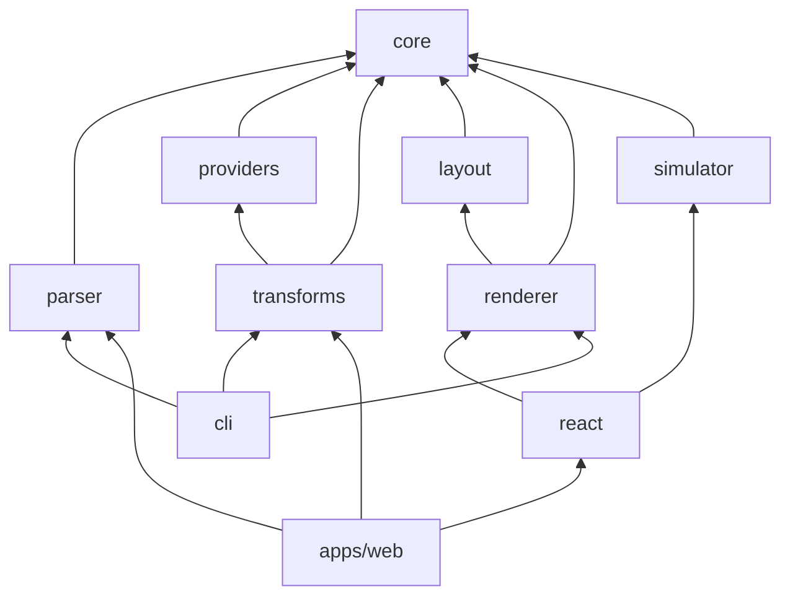

# System architecture

Status: planned design (Phase 0). A package listed here does not exist until
[PROJECT_STATUS.md](../../PROJECT_STATUS.md) marks it implemented.

## Pipeline

Every stage reads and writes the same typed model. Only the parser adapter talks to Mermaid
(ADR-0003).

## Packages and dependency direction

| Package      | Responsibility                                                   | Runs in                 |
| ------------ | ---------------------------------------------------------------- | ----------------------- |
| `core`       | Graph model types, schema validation, diagnostics, serialisation | Node + browser, no DOM  |
| `parser`     | Mermaid source to model; the only package that imports Mermaid   | Node + browser          |
| `providers`  | Service registry, aliases, icon references, naming profiles      | Node + browser          |
| `transforms` | Deterministic, reversible model-to-model transforms              | Node + browser          |
| `layout`     | Node positions and edge routes via ELK                           | Node + browser (worker) |
| `renderer`   | Model + layout to sanitised SVG string                           | Node + browser          |
| `simulator`  | Deterministic event-driven simulation over the model             | Node + browser          |
| `react`      | Interactive canvas components                                    | Browser                 |
| `cli`        | `flowforge` command                                              | Node                    |

`core` depends on nothing internal. No package depends on `react`, `cli` or `apps/*`. A cycle
check will run in CI from Phase 1.

## Constraints to keep

- Original node and edge IDs from the source are preserved, never regenerated.
- Inferred metadata always carries confidence and provenance.
- Nothing outside `parser` imports `mermaid`.
- `core`, `parser`, `transforms`, `layout` and `renderer` never touch the DOM, so the CLI runs
  without a browser.
